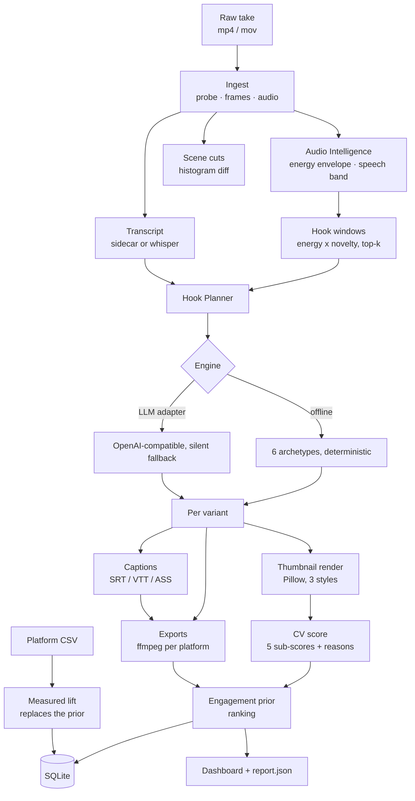
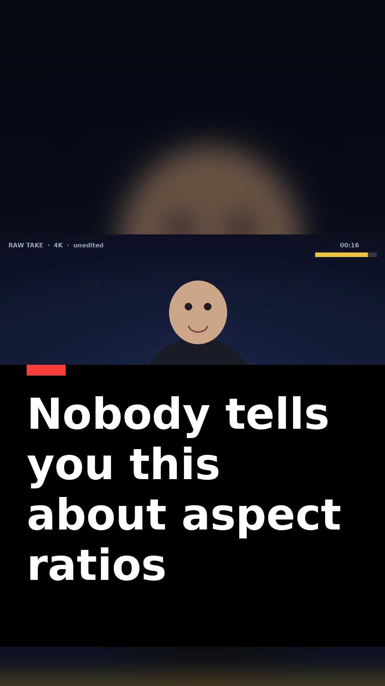

# Hookforge

**An agentic retention studio that turns one long take into ranked, platform-ready hook variants.**

Built for **GeNarrative Clash — Open Track: Empowering the Creative Artist**, challenge area
*Content Strategy & Distribution → Autonomous Creator Agents*.

One upload in. Out comes a set of hook variants — each with a rendered thumbnail and a
CV score, captions cut to each platform's limits, a real MP4 per aspect ratio, and a
ranked recommendation that says *why* one variant beat the others.

```
raw take  ──▶  audio intelligence  ──▶  hook planner  ──▶  visual scorer
                                                              │
        ranked variants  ◀──  engagement model  ◀──  delivery (9:16 / 1:1 / 16:9)
```

| | |
|---|---|
| Language / runtime | Python 3.12, FastAPI, vanilla JS dashboard (no build step, no CDN) |
| Runs offline | Yes — no API key, no model download, no network needed for the demo |
| Tests | 11 pipeline tests + 10 API checks, all passing |
| Measured end-to-end | 3 variants × 2 platforms in **57 s** on a 2-vCPU container |
| Status | ~50 % — working core pipeline, honest roadmap in §12 |

---

## 1. The problem

The track brief for Autonomous Creator Agents states the pain directly:

> "Solo creators lose 60 % of their creative hours wrestling with thumbnail variations,
> multi-platform cutdowns, semantic tagging, and engagement analytics."

Four tasks, one root cause: they are **sequential, manual, and repeated once per
platform**. A creator with one good 24-minute take has to redo the same work four to six
times — and the highest-leverage decision in the whole process, *where the first three
seconds should start*, is still made by scrubbing a timeline and guessing.

Existing tools solve one slice each: a captioner here, a thumbnail generator there, a
scheduler elsewhere. Nothing closes the loop from "raw take" to "ranked variants with a
reason to pick one".

## 2. What Hookforge does

Hookforge is not a video generator. It is the **decision layer** around a take you
already shot: it finds the moments worth opening on, writes hooks against them, scores
what it produced, and delivers each version in the shape a platform will accept.

Four agents, each doing real work on real pixels and real audio:

1. **Audio Intelligence** — decodes the track, builds a 1-second energy envelope and a
   speech-band activity curve, then ranks candidate 3-second opening windows by
   energy × novelty. This is plain DSP, so it is deterministic and reproducible.
2. **Hook Planner** — turns the top windows plus the transcript into hook variants across
   six archetypes (curiosity gap, contrarian, stakes, result-first, question, demo-first),
   each with a written rationale. Two interchangeable engines: a deterministic offline
   copy engine (default) and an OpenAI-compatible LLM adapter that falls back silently.
3. **Visual Scorer** — renders a real thumbnail per variant with Pillow, then scores it
   with OpenCV across five named sub-scores (contrast, colourfulness, subject presence,
   text legibility, clutter). Every score ships with reasons, not just a number.
4. **Delivery + Engagement** — ffmpeg renders per platform with the right crop strategy,
   loudness normalisation and burned-in captions written as a proper ASS file; the
   engagement model ranks variants and is designed to be replaced by your real telemetry.

## 3. What is actually working today (the ~50 %)

| Capability | Status | Where |
|---|---|---|
| Video ingest, probe, frame extraction | ✅ working | `app/pipeline/media.py` |
| Audio decode, energy envelope, speech band, hook windows | ✅ working | `app/pipeline/audio.py` |
| Histogram scene-cut detection | ✅ working | `app/pipeline/media.py` |
| Transcript via sidecar `.txt` / `.srt` / `.vtt` | ✅ working | `app/pipeline/captions.py` |
| Transcript via faster-whisper | ⚙️ implemented, optional dependency, not on the demo path | `app/pipeline/captions.py` |
| Hook planner — deterministic engine | ✅ working | `app/pipeline/hooks.py` |
| Hook planner — LLM adapter | ⚙️ implemented, needs a key, falls back cleanly | `app/pipeline/hooks.py` |
| Thumbnail render (3 styles, 2 framing strategies) | ✅ working | `app/pipeline/thumbs.py` |
| Thumbnail CV scoring with reasons | ✅ working | `app/pipeline/thumbs.py` |
| Captions: SRT + VTT sidecars, ASS burn-in per resolution | ✅ working | `app/pipeline/captions.py` |
| Multi-format export (5 presets, 3 crop strategies, loudnorm) | ✅ working | `app/pipeline/formats.py` |
| Engagement prior + ranking | ✅ working | `app/pipeline/analytics.py` |
| Real telemetry ingestion → measured lift | ✅ working | `app/pipeline/analytics.py` |
| SQLite persistence, REST API, dashboard | ✅ working | `app/main.py`, `app/db.py` |
| Auto-publish to platforms | ❌ not built (needs platform APIs + OAuth review) | — |
| Per-word caption alignment | ❌ not built (needs ASR word timestamps) | — |
| Learned scoring model | ❌ not built (needs telemetry from real accounts) | — |

## 4. Architecture



**Module map**

```
app/
├── config.py              platform presets, paths, ffmpeg resolution
├── db.py                  SQLite schema + queries
├── runner.py              the orchestrator: one function, whole chain
├── main.py                FastAPI routes + static mounts
├── pipeline/
│   ├── media.py           probe, frame grab, audio decode, scene cuts
│   ├── audio.py           envelope, speech band, hook windows
│   ├── hooks.py           archetypes, topic extraction, offline + LLM engines
│   ├── thumbs.py          Pillow rendering, OpenCV scoring
│   ├── captions.py        ASR adapters, cue building, SRT/VTT/ASS writers
│   ├── formats.py         ffmpeg filter graphs, exports, posters
│   └── analytics.py       engagement prior, telemetry ingestion
└── static/                dashboard (index.html, app.js, styles.css)
```

**Design decisions worth defending**

- *One orchestrator, three entry points.* `run_pipeline()` is called by the API, the CLI
  and the tests. The demo video therefore exercises exactly the code the tests cover.
- *ffmpeg resolution is layered.* System binary → static wheel (`imageio-ffmpeg`) → clear
  error. The app runs on a laptop or a bare container with no apt access.
- *Captions are written as ASS, not SRT-with-force_style.* libass lays SRT out on a
  384×288 virtual canvas, so a `FontSize` that looks fine on 720p explodes on 1080×1920.
  Writing a real ASS file with `PlayResX/PlayResY` set to the export resolution and
  explicit `\N` breaks is the only version that reliably fits.
- *Every score is explainable.* The thumbnail score is five weighted sub-scores with
  human-readable reasons. The engagement model is a documented linear prior, labelled as
  a prior everywhere it surfaces. No hidden model, no fake precision.
- *Failures are contained per variant.* One bad render records an `error` on that export
  and the run continues; a missing LLM key degrades to the deterministic engine.

## 5. Technology stack

| Layer | Choice | Why |
|---|---|---|
| API | FastAPI + uvicorn | typed routes, auto OpenAPI docs, trivial to mount static files |
| Video / audio I/O | ffmpeg (system or static wheel via `imageio-ffmpeg`) | one tool for decode, crop, filter, encode, mux |
| Pixel work | OpenCV (headless) | fast frames, colour analysis, edge/legibility metrics |
| Compositing | Pillow | text layout and typography control for thumbnails |
| Numerics | NumPy | envelope, FFT band ratios, timings |
| Store | SQLite (stdlib) | zero-ops persistence; the whole DB is one inspectable file |
| Frontend | vanilla HTML/CSS/JS | no build step, no CDN — loads on a plane |
| LLM (optional) | httpx → any OpenAI-compatible endpoint | swap providers without touching the pipeline |
| ASR (optional) | faster-whisper | local transcription when installed |
| Tests | plain asserts + pytest-compatible | runs with `python tests/test_pipeline.py`, no runner required |

## 6. Quickstart

```bash
git clone <your-repo-url> hookforge && cd hookforge
python -m venv .venv && source .venv/bin/activate      # Windows: .venv\Scripts\activate
pip install -r requirements.txt

# 1. build the demo clip (synthetic 24s take + transcript) — no downloads needed
python scripts/make_sample_assets.py

# 2. run the whole chain from the terminal
python scripts/demo_run.py

# 3. or use the dashboard
uvicorn app.main:app --reload --port 8000
#    open http://127.0.0.1:8000
```

Or `make install sample demo serve`.

ffmpeg: the app uses your system `ffmpeg` if present, otherwise the static binary shipped
by `imageio-ffmpeg` (installed with `requirements.txt`). No apt step required.

## 7. Using it

**Dashboard** (`http://127.0.0.1:8000`)

1. Drop an MP4/MOV on the panel (or press **Run on the sample clip** to skip the upload).
2. Pick delivery targets (Shorts, Reels, TikTok, YouTube 16:9, LinkedIn 1:1), variant
   count, hook length, and copy engine.
3. **Run the agent chain.** You get: source metadata, the audio energy curve with hook
   windows marked, a recommendation card, one card per variant (thumbnail, hook copy,
   score bars, download buttons per platform), and the ranked engagement table.
4. Upload a platform CSV to swap predicted numbers for measured lift.

**CLI**

```bash
python scripts/demo_run.py path/to/take.mp4 \
    --platforms youtube_shorts,tiktok --variants 4 --clip 10
```

**API**

| Method | Route | Purpose |
|---|---|---|
| GET | `/api/health` | liveness, ffmpeg path, libass availability, LLM adapter state |
| POST | `/api/analyze` | upload a video (multipart) → full pipeline report |
| POST | `/api/analyze-with-transcript` | same, with a pasted transcript |
| GET | `/api/demo` | run the chain on the bundled sample clip |
| GET | `/api/videos` | recent runs |
| GET | `/api/videos/{id}` | one run with variants, exports, telemetry |
| POST | `/api/videos/{id}/telemetry` | upload a platform CSV → measured lift |
| GET | `/docs` | generated OpenAPI UI |

## 8. How the numbers are computed

**Thumbnail score (0–100)** — five weighted sub-scores, each computed on the rendered JPEG:

| Sub-score | Weight | Measured as |
|---|---|---|
| Contrast | 0.28 | std-dev of luma, normalised |
| Colourfulness | 0.18 | Hasler–Süsstrunk metric, normalised |
| Subject presence | 0.26 | face area via Haar cascade, else skin-tone salience |
| Text legibility | 0.18 | inverse of local gradient noise under the text box |
| Cleanliness | 0.10 | inverse of Canny edge density |

> OpenCV ≥ 5 removed the cascade API. The scorer detects that at import and falls back to
> a skin-tone salience proxy for "is there a human subject, and how big". The method used
> is reported in every result as `subject_method`.

**Engagement prior** — deliberately a documented linear model, not a black box:

```
watch_through = 0.22
              + 0.30 · thumb_score/100
              + 0.18 · energy_match          # hook window vs. video's mean audio energy
              + 0.16 · copy_strength         # numbers, "you", curiosity words, length
              + platform_prior               # 0.030 – 0.075 per platform
              - duration_penalty             # rises after 20 s
```

Clamped to 5–92 %. Thumb CTR and engagement rate use the same style of formula.

**This is a prior, not a measurement.** It exists so a creator gets a ranking before any
impressions exist. Upload the platform CSV (`variant_id, platform, impressions, views,
avg_watch_s, likes, comments, shares`) and the app reports *measured* watch-through,
measured CTR and the lift against the prior instead. The dashboard and the API say which
one you are looking at.

## 9. Delivery presets

| Preset | Resolution | Crop | Caption limits | Max length |
|---|---|---|---|---|
| YouTube Shorts | 1080×1920 | centre | 32 chars × 2 lines | 60 s |
| Instagram Reels | 1080×1920 | centre | 30 chars × 2 lines | 90 s |
| TikTok | 1080×1920 | centre | 28 chars × 2 lines | 60 s |
| YouTube | 1920×1080 | fit (letterbox) | 42 chars × 2 lines | — |
| LinkedIn | 1080×1080 | blur-pad | 38 chars × 2 lines | 180 s |

Thumbnails for vertical presets use blur-pad framing so a 16:9 take is not decapitated by
a centre crop; 16:9 and 1:1 use cover. Exports are H.264 + AAC, `+faststart`, loudness
normalised to −14 LUFS (the streaming target), with captions burned from a per-resolution
ASS file and an `.srt`/`.vtt` sidecar for upload.

## 10. Verified output on the bundled sample

The repo ships a synthetic 24 s "raw take" (`samples/sample_creator_clip.mp4`, 1280×720,
scene changes every 4 s, loud passages at 4–8 s and 16–20 s) so a judge can run everything
with no assets of their own. Real measured run:

```
$ python scripts/demo_run.py --platforms youtube_shorts,youtube --variants 3 --clip 10
source      1280x720 @ 12.0 fps · 24.0s · audio=True
transcript  sidecar (I spent three years editing my own videos and losing the first thousan…)
engine      offline · topic "aspect ratios"
hook windows 16.0s, 5.0s, 2.0s, 19.0s, 11.0s     ← audio peaks found independently
scene cuts   4.0, 8.0, 12.0, 16.0, 20.0           ← exact scene boundaries
```

| Rank | Archetype | Hook | Thumb | Watch-through | Starts at |
|---|---|---|---|---|---|
| 1 | curiosity_gap | "Nobody tells you this about aspect ratios" | 47.1 | 71.5 % | 16.0 s |
| 2 | result_first | "This is the result. Here's the 12 seconds that made it." | 39.3 | 69.5 % | 2.0 s |
| 3 | contrarian | "Stop doing aspect ratios like this" | 42.2 | 67.8 % | 5.0 s |

Total wall time **57.2 s** for 3 variants × 2 platforms (6 rendered MP4s + 3 thumbnails +
captions). The full JSON report is in [`docs/assets/sample-report.json`](docs/assets/sample-report.json).

Rendered thumbnail from that run (blur-pad framing for 9:16, text fitted to the safe area):



Note the ranking is not simply thumbnail order: variant 3 scores higher on the thumbnail
but loses on hook energy match, which is exactly the trade-off the model is meant to
surface.

## 11. How this maps to the track's four sub-problems

| Track sub-problem | What Hookforge does | Where |
|---|---|---|
| Thumbnail variations | renders N styled thumbnails per run, scores each with reasons | `pipeline/thumbs.py` |
| Multi-platform cutdowns | one source → 5 presets, 3 crop strategies, per-platform caption limits | `pipeline/formats.py`, `config.py` |
| Semantic tagging | transcript → topic phrase → archetype rationale → caption cues | `pipeline/hooks.py`, `pipeline/captions.py` |
| Engagement analytics | documented prior, then real telemetry ingestion with measured lift | `pipeline/analytics.py` |

## 12. Roadmap to 100 %

**Next (2 weeks)** — close the loop on the demo path
1. Enable `faster-whisper` by default with word timestamps → real per-word caption alignment.
2. Persist hook-window thumbnails in a contact sheet so the creator can override the
   auto-picked start in the UI.
3. Publish adapters: YouTube Data API (thumbnail + metadata), then Buffer/Later for
   scheduling. This is the only part that needs OAuth review.
4. Background job queue so a 20-minute take does not block the request.

**Then (4–8 weeks)** — from prior to learned model
5. Replace the linear prior with a gradient-boosted model trained on the creator's own
   telemetry (the SQLite schema already stores the features and the outcomes side by side).
6. Vector memory over past variants: "this archetype under-performed on this channel".
7. Multi-take batching: one shoot → 8 hooks, ranked, scheduled across a week.
8. Human-in-the-loop review queue with one-click accept/reject per variant.

## 13. Repository layout

```
.
├── app/                    application package (see §4)
├── docs/
│   ├── ARCHITECTURE.md     deeper design notes and trade-offs
│   ├── DEMO_SCRIPT.md      shot-by-shot video script
│   ├── SUBMISSION.md       every submission field, filled
│   └── assets/             rendered thumbnail, poster, sample report
├── samples/                synthetic demo clip + sidecar transcript
├── scripts/
│   ├── make_sample_assets.py   builds the demo clip (Pillow + ffmpeg)
│   ├── demo_run.py             CLI end-to-end run
│   └── smoke_api.py            10 in-process API checks
├── tests/test_pipeline.py  11 pipeline tests
├── requirements.txt
├── Makefile
└── README.md
```

## 14. Tests

```bash
python tests/test_pipeline.py     # 11 tests, no pytest needed (also runs under pytest -q)
python scripts/smoke_api.py       # 10 API checks against the real app
```

The suite asserts behaviour, not snapshots: that the audio envelope finds the sample's
known loud passages, that hook windows are ranked and non-overlapping, that the offline
planner is deterministic and platform-bounded, that SRT timestamps are well formed, that
the prior is monotonic in thumbnail score, that telemetry overrides the prior, and that a
full run produces a real 1080×1080 MP4 on disk.

## 15. Limitations, stated plainly

- **The engagement model is a prior.** It ranks *your* variants against each other using
  signals with defensible direction, not magnitudes. It does not predict any platform's
  algorithm, and the UI says so.
- **Topic extraction is a heuristic.** It drops numbers, time words and common verbs before
  choosing a two-word phrase, because ungrammatical hook copy is worse than generic copy.
  The LLM adapter replaces it entirely when configured.
- **ASR is optional.** The demo uses a sidecar transcript. Without one, hooks fall back to
  subject-free templates rather than inventing a topic from a filename.
- **Caption timing is proportional**, not word-aligned, unless faster-whisper provides
  timestamps. It is documented in the code and in §8.
- **The sample clip is synthetic.** It exists so the project is reproducible; run it on a
  real take to see real behaviour.

## 16. Demo video

Public walkthrough (~3½ minutes): **[paste link here — YouTube / Drive / Loom / Vimeo]**

Shot-by-shot script and recording checklist: [`docs/DEMO_SCRIPT.md`](docs/DEMO_SCRIPT.md).

## 17. Team — CodeDev#02

| Role | Name |
|---|---|
| Team leader | Bibek Chakraborty |
| Team size | 3 |
| Contact | bibekchakraborty58@gmail.com · +91 9875615461 |

## 18. License

MIT — see [`LICENSE`](LICENSE).
